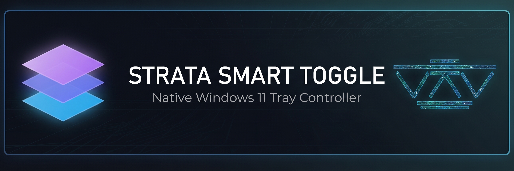
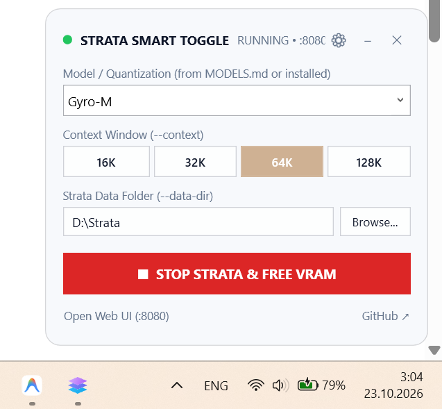
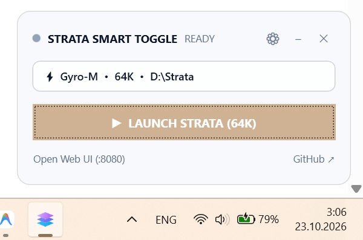

<div align="center">
  

  <br><br>

  <a href="https://github.com/Niko1221/Strata"></a>
  <a href="#-quick-build--pin-10-seconds"></a>
  <a href="StrataSmartToggle.cs"></a>
  <a href="build.ps1"></a>
  <a href="LICENSE"></a>
</div>

<br>

> [!NOTE]
> **StrataSmartToggle** turns [Strata](https://github.com/Niko1221/Strata) into a true Windows 11 taskbar utility. Launch massive local MoE models, switch context windows (`16K`–`128K`), and instantly reclaim VRAM from a sleek taskbar flyout without keeping console windows open.

---

## ⚡ Interface & Workflow

<table>
  <tr>
    <th width="50%">🎛️ First-Run / Full Setup Mode</th>
    <th width="50%">⚡ Subsequent Launch (Compact Mode)</th>
  </tr>
  <tr>
    <td align="center" valign="bottom">
      
    </td>
    <td align="center" valign="bottom">
      
    </td>
  </tr>
  <tr>
    <td valign="top">
      <p>Configure your local inference parameters on first run (or anytime via <kbd>⚙️</kbd>):</p>
      <ul>
        <li><b>Model / Quantization:</b> Select from <code>MODELS.md</code> or local weights (<code>Gyro-M</code>, <code>Gyro-S</code>, <code>Q2_0</code>, <code>IQ3_S</code>)</li>
        <li><b>Context Selector:</b> Instant toggle between <kbd>16K</kbd> <kbd>32K</kbd> <kbd>64K</kbd> <kbd>128K</kbd></li>
        <li><b>Data Directory:</b> Custom path picker for <code>--data-dir</code> (e.g., <code>D:\Strata</code>)</li>
      </ul>
    </td>
    <td valign="top">
      <p>On every subsequent launch, the window remembers your preset and opens in a compact 1-click mode:</p>
      <ul>
        <li><b>Saved Preset Badge:</b> Shows active configuration in one line:<br><code>⚡ Gyro-M • 64K • D:\Strata</code></li>
        <li><b>1-Click Action:</b> Instantly switches between <kbd>▶ LAUNCH STRATA</kbd> (Ready) and <kbd>■ STOP STRATA & FREE VRAM</kbd> (Running on <code>:8080</code>)</li>
        <li><b>Gear Toggle:</b> Click <kbd>⚙️</kbd> in the title bar to expand full settings anytime</li>
      </ul>
    </td>
  </tr>
</table>

---

## 🛡️ Architecture Highlights

<table>
  <tr>
    <td width="33%" valign="top">
      <h4>🛑 Graceful VRAM Unload</h4>
      <p>Clicking <kbd>■ STOP STRATA & FREE VRAM</kbd> executes <code>strata launch --stop</code>, waits for port <code>8080</code> to release, and cleanly terminates background processes so zero zombie allocations remain in GPU memory.</p>
    </td>
    <td width="33%" valign="top">
      <h4>🪶 Zero External Dependencies</h4>
      <p>Compiles in under <b>1 second</b> using the built-in Windows .NET compiler (<code>csc.exe</code>). No Visual Studio, no Electron bloat, no Node.js, and zero third-party NuGet packages required.</p>
    </td>
    <td width="33%" valign="top">
      <h4>🪟 Dedicated Taskbar Identity</h4>
      <p>Registers a unique Windows <code>AppUserModelID</code>. Pins directly to your Windows 11 taskbar with its own icon and never groups with <code>powershell.exe</code> or <code>cmd.exe</code>.</p>
    </td>
  </tr>
</table>

---

## 🚀 Quick Build & Pin (10 Seconds)

Open **PowerShell** in the repository directory and run:

```powershell
.\build.ps1
.\StrataSmartToggle.exe
```

1. Right-click the **StrataSmartToggle** icon on your Windows 11 Taskbar.
2. Select **Pin to taskbar** for permanent 1-click access.
3. Use built-in quick links at the bottom of the widget to open **Web UI (`:8080`)** or **GitHub Docs**.

---

<div align="center">
  <sub>Built by <a href="[https://vkvstudio.com](https://vkvstudio.com)"><b>VKVstudio</b></a> • Released under the <a href="LICENSE">MIT License</a></sub>
</div>